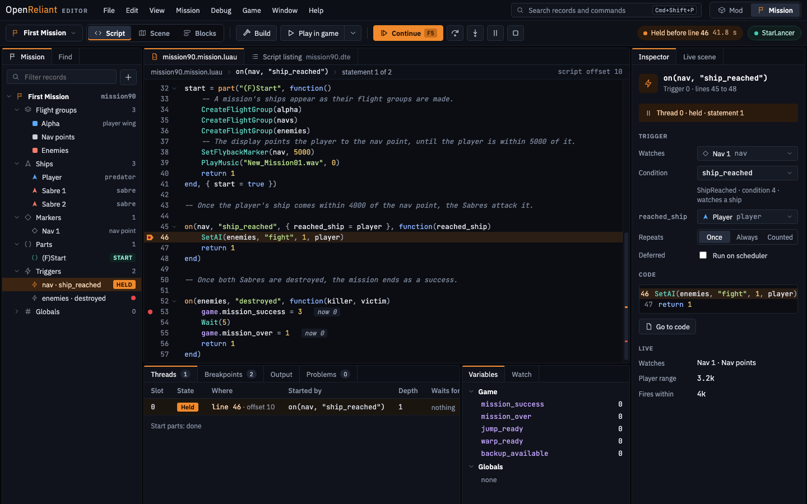

# OpenReliant Editor

A mission editor, script debugger and mod editor for
[OpenReliant](https://github.com/OpenReliant/openreliant), the open-source reimplementation of
StarLancer's engine. It links to the running game, so that a change to a mission or a mod shows in
the game as it's made.

**Status:** design, before any code. The plan is OpenReliant's
[#1126](https://github.com/OpenReliant/openreliant/issues/1126), and the [design](design/README.md)
shows every screen.

## What it will do

- **Mission mode:** the Script, Scene and Blocks views of one mission, with a debugger that steps
  through the mission's script as the game plays it, and a guided path through a first mission.
- **Mod mode:** the manifest, the mod's Luau code with the game's console, the game's files to
  compare and replace, and packing for the catalogue.
- A native app in Zig, on SDL3 and Dear ImGui, that reads missions and mods exactly as OpenReliant
  does.

It needs OpenReliant and your own copy of StarLancer.

## Licence

[Mozilla Public License 2.0](LICENSE), as OpenReliant.
