# The editor's design

The screens of OpenReliant Editor as they're planned. Each is an HTML page in [`screens`](screens)
that opens in any browser, with a picture of it in [`images`](images). The plan behind them is
OpenReliant's [#1126](https://github.com/OpenReliant/openreliant/issues/1126).

The mission screens use the first mission of OpenReliant's
[guide to writing missions](https://github.com/OpenReliant/openreliant/blob/main/docs/guide/missions.md),
with the script listing `sltool dte script` gives for it. The mod screens use OpenReliant's example
mods Bananas and Music.

## Modes and views

The editor opens a mod: a folder in the game's `mods` folder. A mission is one of the mod's files.

- **Mission mode** works on one mission of the mod. Script, Scene and Blocks are three views of it,
  a tab apart (Ctrl+1 to 3, or Cmd+1 to 3 on macOS), with one selection, one undo history and one
  debugger across them.
- **Mod mode** works on the mod as a whole, in four views: Manifest, Code, Game files and Share. A
  mission in the mod opens in Mission mode.

## Beginners and experts

- The guided layout walks through a first mission step by step, and shows the source each step
  writes. The full layout shows every panel. Both are presets of the same dock layout.
- Blocks, forms and the map all write the same mission source, which is always a tab away.
- Every action has a button, a menu item, a command in the palette (Ctrl+Shift+P) and a key.
- An error says what's wrong in a few words, and offers the fix.
- The script listing, offsets, conditions on breakpoints and the game's state are there for those
  who want them, out of a beginner's way.

## Text on screen

Labels and short fragments rather than sentences: `Held · line 46`, `1 problem`, `Use enemies`.
Technical terms are fine where they're the clearest word, such as breakpoint, log point, hot swap
or opcode. The game's own text, such as its commands' descriptions, shows as the game has it.

## The look

- Dear ImGui's docking layout, dark, in OpenReliant's colours: `#07080c` behind the panels,
  `#10131b` for the panels, and `#f08a2c` for the focus and a held script.
- IBM Plex Sans for the interface, JetBrains Mono for code and values, and Newtown, the font
  OpenReliant carries built in, for the name ([fonts](fonts/README.md)).
- Red marks breakpoints and errors, teal a linked game, and each flight group has a colour of its
  own on the map and in the outline. A shape or a label always says the same as the colour.

## Platforms

The editor runs on Windows, macOS and Linux, on x86-64 and Arm: the six systems OpenReliant is
built for.

- One layout everywhere. Dear ImGui draws the whole interface, its menus included, with the fonts
  the editor carries, so a screen looks the same on each system. SDL3 gives each system's own
  windows, file dialogs, clipboard and display scaling, and SDL_GPU draws with Vulkan on Windows and
  Linux and with Metal on macOS, as OpenReliant does.
- Keys follow each system. The screens show the keys of Windows and Linux. On macOS, Cmd takes
  Ctrl's place, and debugging uses Xcode's keys, since macOS keeps F11 to show the desktop and its
  F-keys are media keys by default. The [Keys](#keys) screen sets the two key maps side by side.
- Paths show with each system's separator, and the editor starts the game by its name on each
  system: `openreliant`, or `openreliant.exe` on Windows.
- Releases build for the same six systems as OpenReliant's, and each pull request builds and tests
  the editor on Windows, macOS and Linux.

## The screens

### Start

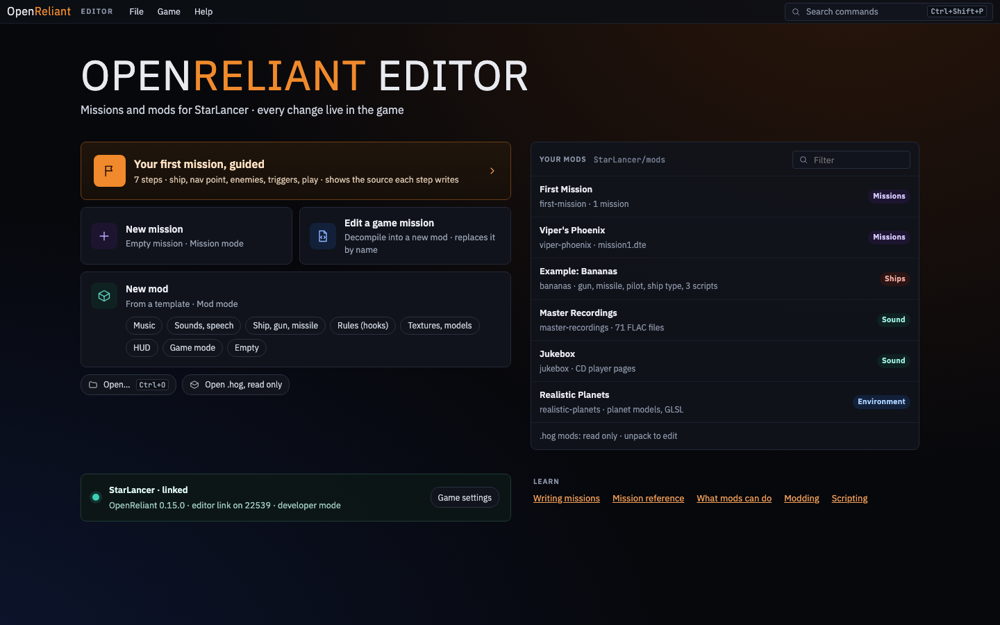

[Page](screens/start.html). The guided first mission, a new mission or mod from a template, a
mission of the game's to change, the mods in the game's `mods` folder, and the linked game.

### Mission mode

#### Script


[Page](screens/mission-script.html). The script held at a breakpoint: the current line and the
breakpoints in the gutter, the game's variables shown inline, the threads, the variables, and the
inspector of the trigger that runs.

#### Scene

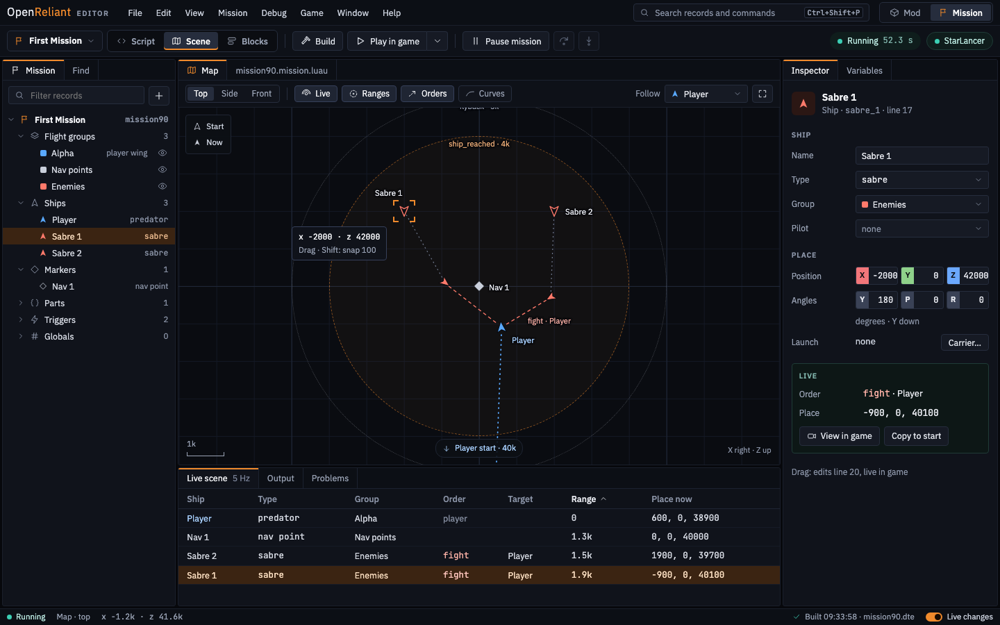

[Page](screens/mission-scene.html). The map from above, with each ship's start and where it is now
in the game, the triggers' ranges and the ships' orders. Dragging a ship rewrites its line of the
source and moves it in the running game. The live scene lists every object with its order, target
and range.

#### Blocks

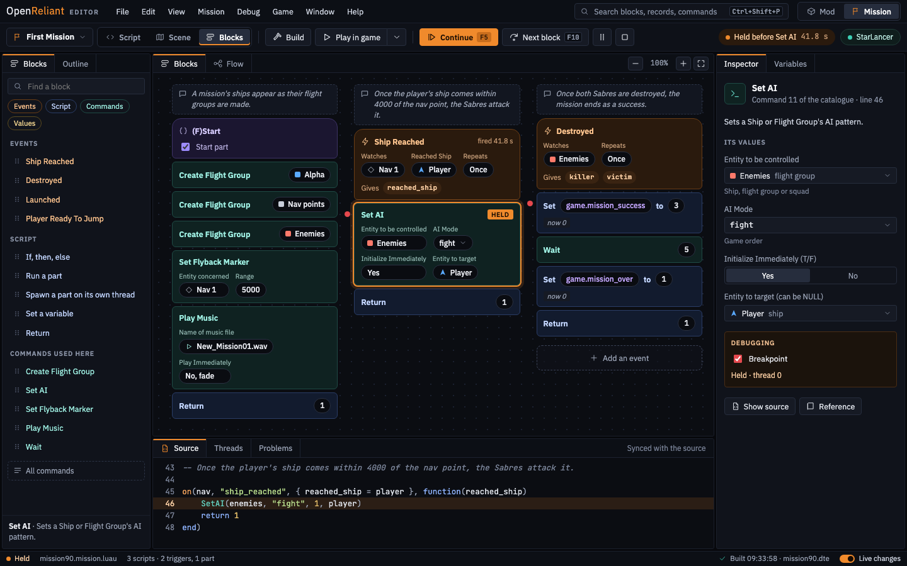

[Page](screens/mission-blocks.html). The same script as blocks, made from the game's command and
condition catalogues, with their labels as the slots' names. Breakpoints and the held statement
show on the blocks, and the source of the selected block shows underneath.

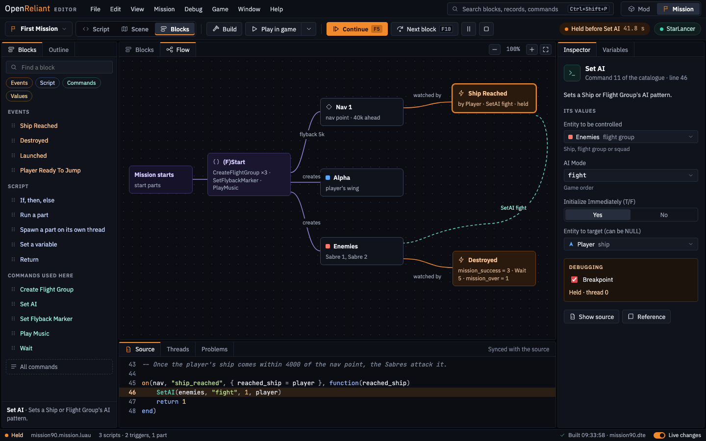

[Page](screens/mission-blocks-flow.html). The Flow tab: the mission as a graph of its parts,
triggers and the records they watch and order.

#### Guided

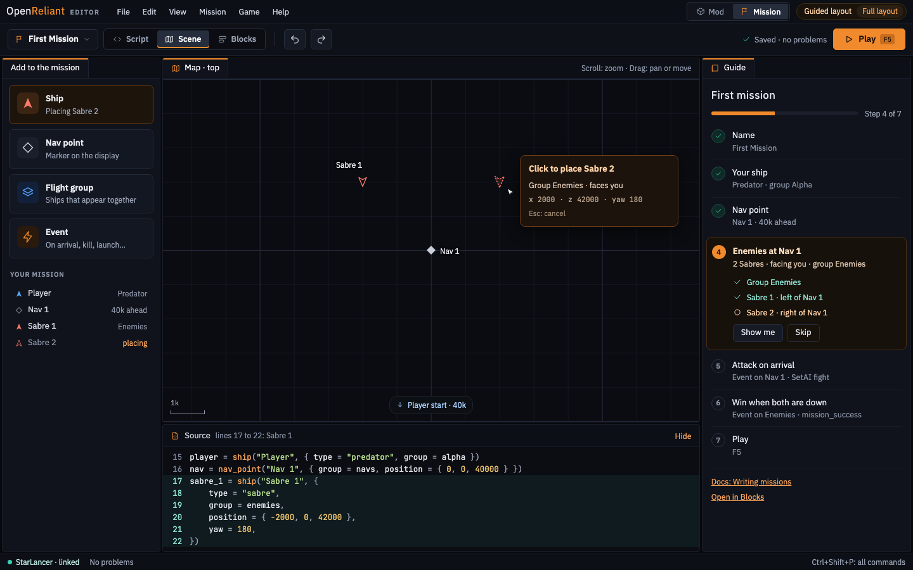

[Page](screens/mission-guided.html). The Scene view in the guided layout: a panel of steps, things
to add, and the source the steps have written so far.

#### Writing

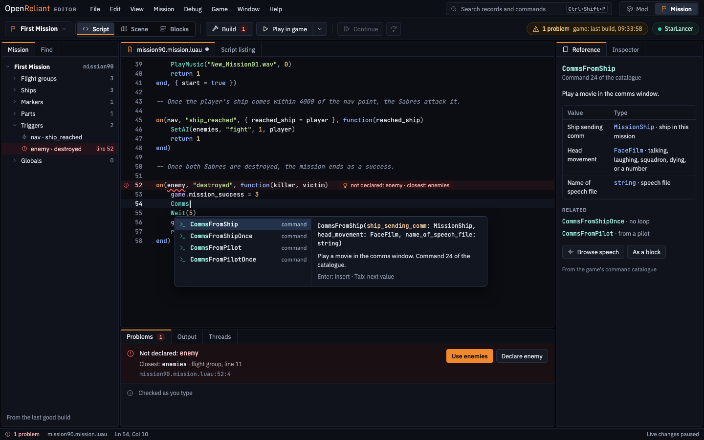

[Page](screens/mission-writing.html). A build error under the text with its fix, completion with the
catalogue's descriptions, and the command's reference. The game keeps playing the last good build.

#### Debugging

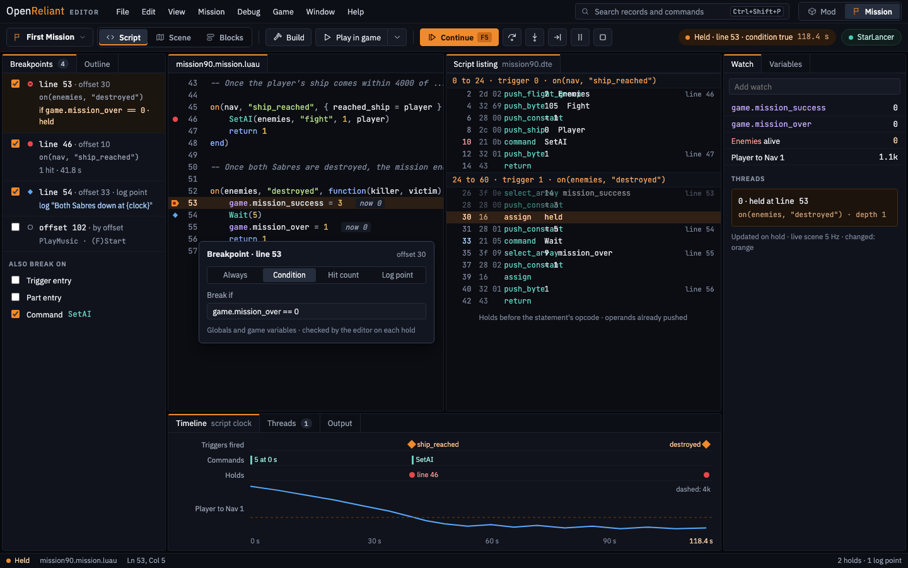

[Page](screens/mission-debugging.html). The script listing beside the source, breakpoints with
conditions and log points, which the editor checks each time the game holds, watches, and a
timeline of the run on the script clock.

### Command palette

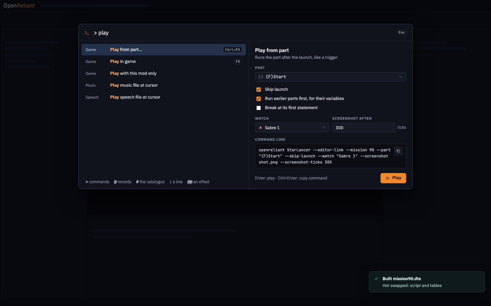

[Page](screens/command-palette.html). Every command by name, and Play from a part with the same
run as a command line.

### Mod mode

#### Manifest

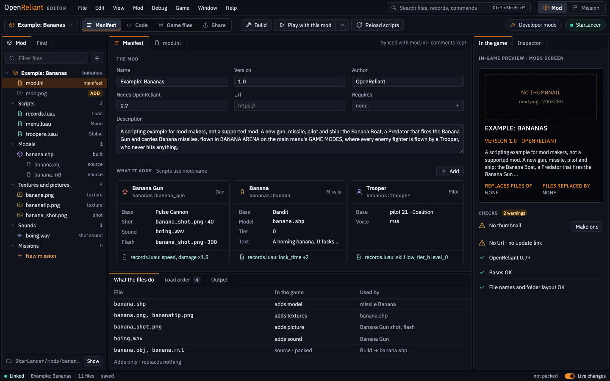

[Page](screens/mod-manifest.html). The manifest as a form, what the mod adds, the mods screen's
panel as players see it, the checks, what each file does in the game, and the load order.

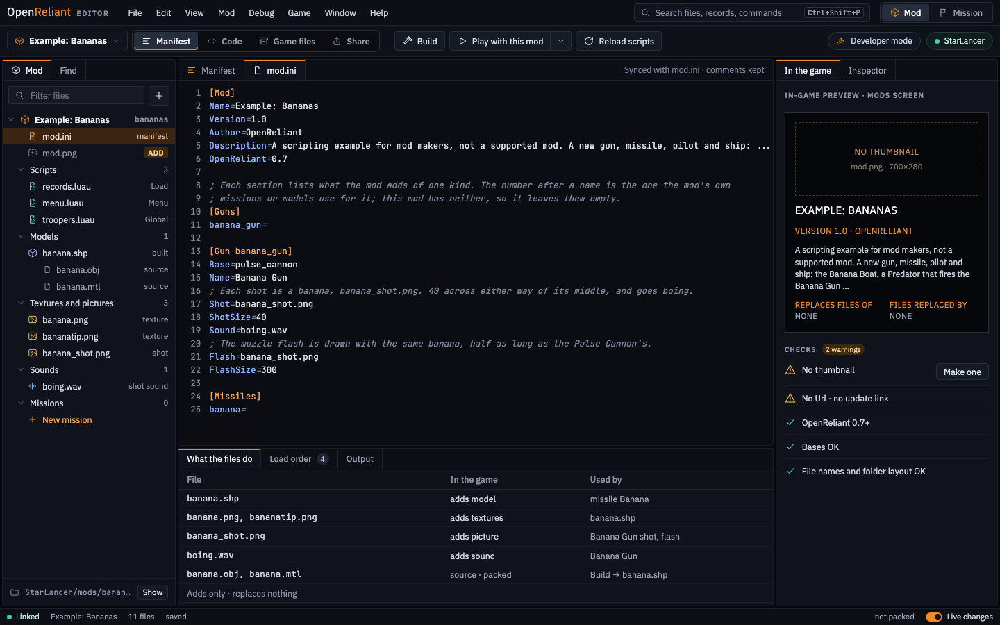

[Page](screens/mod-manifest-ini.html). The same manifest as `mod.ini`, comments included.

#### Code

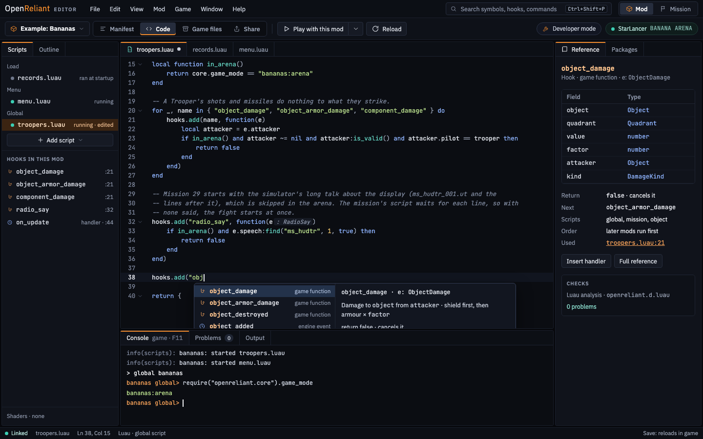

[Page](screens/mod-code.html). A mod's Luau script with the hooks' completion and reference from
`openreliant.d.luau`, the hooks the mod uses, and the game's console.

#### Game files

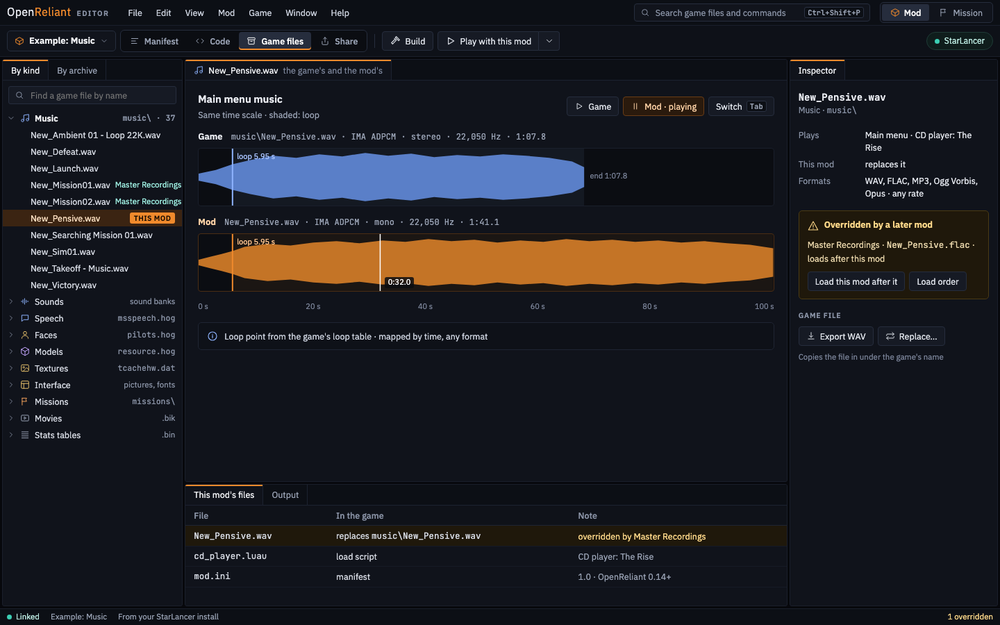

[Page](screens/mod-game-files.html). The game's files by kind, a piece of music compared with the
mod's at the same scale with their loop points, and a warning when a mod loaded later replaces the
same file.

#### Share

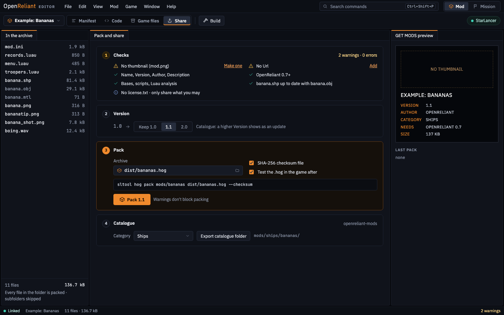

[Page](screens/mod-share.html). The checks, the next version, packing into a `.hog` with its
checksum, and the export for the mods catalogue, with the catalogue's entry as players will see it.

### Keys

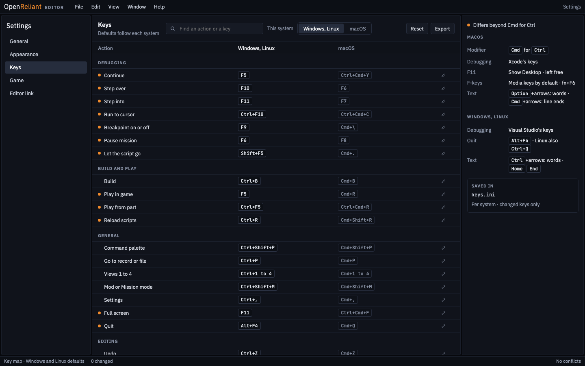

[Page](screens/keys.html). Every action's keys on Windows and Linux and on macOS, side by side,
with the current system's in front. An orange dot marks an action whose keys differ by more than
Cmd for Ctrl. Changed keys are saved for each system on its own.

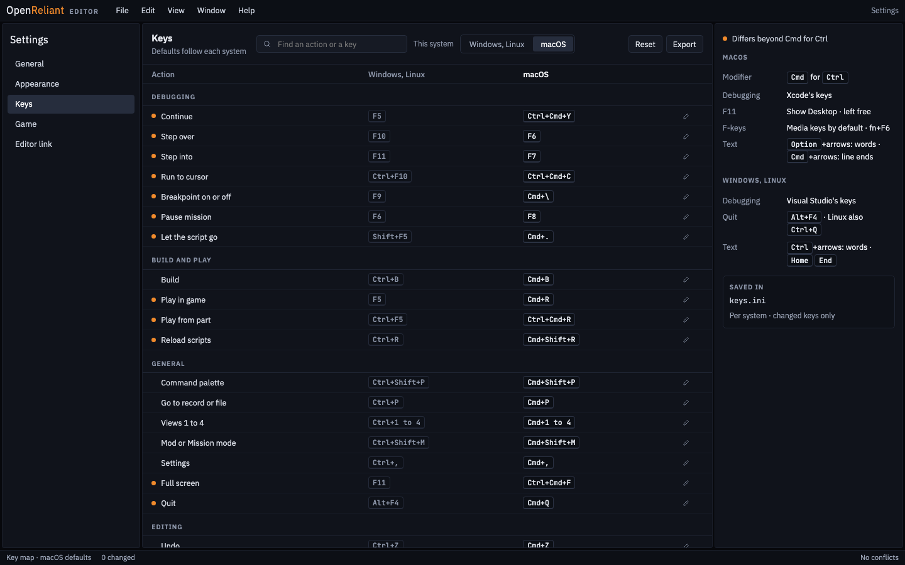

[Page](screens/keys-macos.html). The same settings on macOS.

## Libraries

| Part | Library |
|---|---|
| Window, input, GPU | SDL3 with SDL_GPU, as OpenReliant |
| Interface | Dear ImGui, docking branch, through Dear Bindings' C API |
| Source views | ImGuiColorTextEdit |
| Map, waveforms, timeline | ImPlot |
| Flow graph | imgui-node-editor |
| Command palette | imgui-command-palette |
| Notifications | imgui-notify |
| Icons | Lucide, through IconFontCppHeaders |
| Blocks | ImGui's draw lists and drag and drop |

## What the screens need from OpenReliant

- The live scene: [#1059](https://github.com/OpenReliant/openreliant/issues/1059)
- The editor's live changes to the mission: [#1057](https://github.com/OpenReliant/openreliant/issues/1057)
- Playing a mission from a part: [#577](https://github.com/OpenReliant/openreliant/issues/577)
- The mission format as a package: [#1060](https://github.com/OpenReliant/openreliant/issues/1060)
- The game's console and reloading mods' scripts: [#1201](https://github.com/OpenReliant/openreliant/issues/1201)
- Starting with a chosen set of mods: [#1202](https://github.com/OpenReliant/openreliant/issues/1202)
- Exporting a mod for the catalogue: [#1203](https://github.com/OpenReliant/openreliant/issues/1203)

## Changing the design

The pages are plain HTML and CSS. After changing one, take its picture again with
[`pictures.sh`](pictures.sh), which uses Chrome or Chromium on any of the three systems (on Windows,
from Git Bash):

```bash
design/pictures.sh
```
